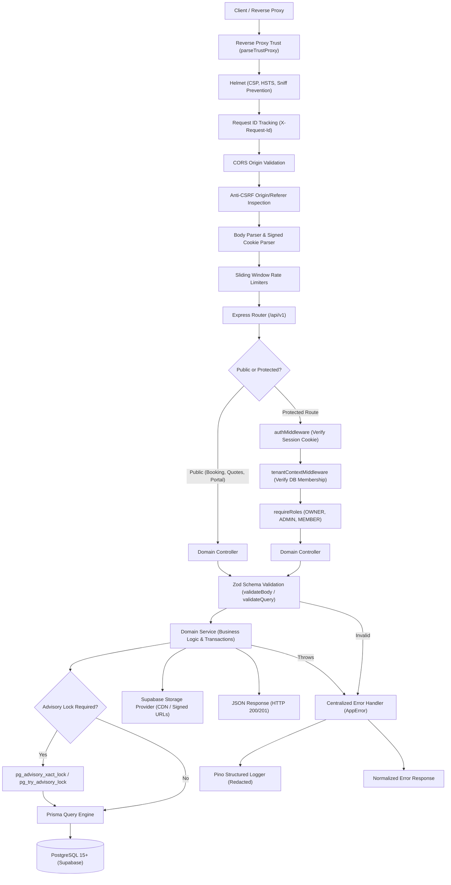
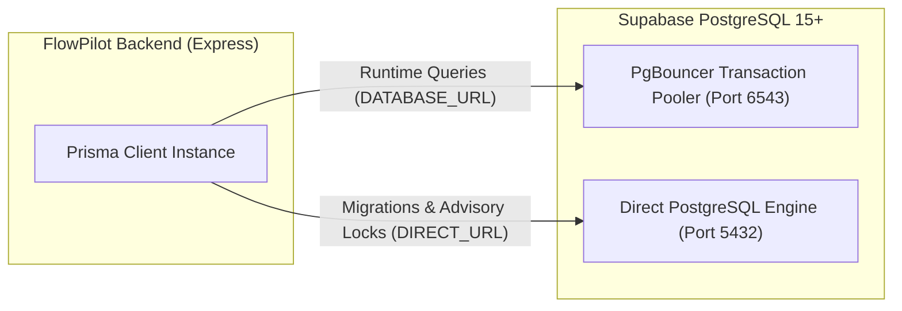

# FlowPilot Backend — Core Multi-Tenant Platform & API Engine

[](https://nodejs.org/)
[](https://expressjs.com/)
[](https://www.typescriptlang.org/)
[](https://www.prisma.io/)
[](https://www.postgresql.org/)
[](https://vitest.dev/)
[](https://github.com/napi-rs/node-rs)
[](https://helmetjs.github.io/)

> **"A resilient, multi-tenant API engine engineered for high-concurrency business operations, strict data isolation, and cryptographic contracting."**

FlowPilot Backend is the foundational API and domain persistence engine powering the FlowPilot Business Operations SaaS platform. Architected as a modular monolith in strict TypeScript, it delivers zero-trust multi-tenancy, PostgreSQL transaction-level advisory locks for concurrency safety, collision-free sequential invoice generation, Argon2id authentication with side-channel mitigation, and native Supabase cloud storage integration.

Frontend counterpart: [`flowpilot`](https://github.com/iamrakibhussain/flowpilot) (Next.js 16 App Router & React 19).

---

## Table of Contents

- [1. Architectural Overview & Design Philosophy](#1-architectural-overview--design-philosophy)
- [2. System Topology & Request Lifecycle](#2-system-topology--request-lifecycle)
- [3. Technology Stack & Key Decisions](#3-technology-stack--key-decisions)
- [4. REST API Directory & Route Catalog](#4-rest-api-directory--route-catalog)
- [5. Zero-Trust Multi-Tenant Isolation](#5-zero-trust-multi-tenant-isolation)
- [6. Concurrency Engineering & Advisory Locks](#6-concurrency-engineering--advisory-locks)
- [7. Authentication & Cryptographic Security](#7-authentication--cryptographic-security)
- [8. Database Architecture & Dual-Connection Pooling](#8-database-architecture--dual-connection-pooling)
- [9. Validation, Error Handling & Logging](#9-validation-error-handling--logging)
- [10. Cloud Object Storage Abstraction](#10-cloud-object-storage-abstraction)
- [11. Billing Engine & Background Schedulers](#11-billing-engine--background-schedulers)
- [12. Repository Directory Structure](#12-repository-directory-structure)
- [13. Local Development & Installation](#13-local-development--installation)
- [14. Environment Variables Reference](#14-environment-variables-reference)
- [15. Automated Testing & Quality Verification](#15-automated-testing--quality-verification)
- [16. Production Deployment Blueprint (Render)](#16-production-deployment-blueprint-render)
- [17. Portfolio Demonstration Context & Limitations](#17-portfolio-demonstration-context--limitations)
- [18. Engineering Roadmap](#18-engineering-roadmap)
- [19. Author & License](#19-author--license)

---

## 1. Architectural Overview & Design Philosophy

FlowPilot Backend adheres to a **modular monolith** architectural pattern. Rather than introducing premature microservice network latency and distributed transaction complexity, domain boundaries are enforced through clean layered abstraction:

```
┌─────────────────────────────────────────────────────────────┐
│                 HTTP Transport Layer (Express)              │
│   Routing, Helmet, Rate Limiting, Cookie & Origin Parsers   │
└──────────────────────────────┬──────────────────────────────┘
                               │
┌──────────────────────────────▼──────────────────────────────┐
│                Middleware & Context Pipeline                │
│   Request ID, Auth Token Verification, Tenant Context (DB)  │
└──────────────────────────────┬──────────────────────────────┘
                               │
┌──────────────────────────────▼──────────────────────────────┐
│             Domain Controllers & Zod Validation             │
│    Payload schema parsing, HTTP status mapping, AppError    │
└──────────────────────────────┬──────────────────────────────┘
                               │
┌──────────────────────────────▼──────────────────────────────┐
│                    Domain Service Layer                     │
│  Business rules, atomic transactions, advisory locks, logic  │
└──────────────────────────────┬──────────────────────────────┘
                               │
┌──────────────────────────────▼──────────────────────────────┐
│               Data Persistence & Storage Layer              │
│    Prisma ORM, PostgreSQL (PgBouncer), Supabase Storage     │
└─────────────────────────────────────────────────────────────┘
```

### Key Engineering Principles

- **Strict Tenant Boundary Enforcement:** Every database read and write query is explicitly scoped to the verified `organizationId`. Client-supplied tenant assertions are never trusted without server-side database membership verification.
- **Race Condition Immunity:** High-concurrency operations (such as last-owner demotion, appointment slot booking, and sequence allocation) utilize PostgreSQL transaction-level advisory locks (`pg_advisory_xact_lock`) and atomic UPSERT mechanics.
- **Defense-in-Depth Security:** Memory-hard Argon2id password hashing, constant-time dummy verifications against user enumeration, anti-CSRF origin validation, and automatic privacy redaction of email logs.
- **Stateless Cloud Portability:** Session state is managed via cryptographically signed HTTP-only cookies, enabling seamless horizontal scalability and zero sticky-session reliance.

---

## 2. System Topology & Request Lifecycle

Every inbound HTTP request progresses through a standardized, hardened middleware pipeline before reaching the target domain service:



---

## 3. Technology Stack & Key Decisions

| Component            | Technology             | Version           | Architectural Purpose & Justification                                                                |
| :------------------- | :--------------------- | :---------------- | :--------------------------------------------------------------------------------------------------- |
| **Runtime**          | Node.js LTS            | `>=20.0.0`        | High-throughput asynchronous event loop with native fetch and Web Crypto support.                    |
| **Framework**        | Express                | `4.21.2`          | Minimalist, un-opinionated HTTP transport allowing precise middleware ordering and low overhead.     |
| **Language**         | TypeScript             | `5.7.3`           | Strict type safety (`strict: true`, `noImplicitAny: true`) preventing runtime type coercion errors.  |
| **Database ORM**     | Prisma Client & CLI    | `6.4.1`           | Type-safe query generation, declarative schema modeling, and robust automated migrations.            |
| **Database Engine**  | PostgreSQL             | `15+`             | ACID-compliant relational persistence with advisory lock primitives and row-level sequence UPSERTs.  |
| **Password Hashing** | `@node-rs/argon2`      | `2.0.2`           | Rust-native, memory-hard Argon2id implementation resistant to GPU/ASIC brute-force attacks.          |
| **Validation**       | Zod                    | `3.24.2`          | Composable runtime schema validation with automatic TypeScript type inference.                       |
| **Security Headers** | Helmet                 | `8.0.0`           | Comprehensive HTTP security headers (HSTS, Content-Security-Policy, X-Frame-Options).                |
| **Rate Limiting**    | Express Rate Limit     | `7.5.0`           | Memory-efficient sliding-window rate limiters protecting authentication, booking, and API endpoints. |
| **Logging**          | Pino & Pino-HTTP       | `9.6.0`           | Ultra-fast structured JSON logging with custom credential and token redaction rules.                 |
| **Cloud Storage**    | `@supabase/storage-js` | Custom Provider   | Direct CDN streaming for public assets and 900-second HMAC signed URLs for private contracts.        |
| **Testing**          | Vitest & Supertest     | `3.0.7` / `7.0.0` | Instantaneous test execution with native ESM support and end-to-end HTTP integration testing.        |

---

## 4. REST API Directory & Route Catalog

All API endpoints are mounted under `/api/v1` and follow standard RESTful conventions. Responses are returned in uniform JSON envelopes (`{ success: true, data: ... }` or `{ success: false, error: ... }`).

### 1. Health & Telemetry

| Method | Endpoint         | Auth   | Description                                                                     |
| :----- | :--------------- | :----- | :------------------------------------------------------------------------------ |
| `GET`  | `/api/v1/health` | Public | Liveness and readiness probe reporting uptime, memory usage, and database ping. |

### 2. Authentication & Sessions

| Method | Endpoint                       | Auth    | Description                                                                  |
| :----- | :----------------------------- | :------ | :--------------------------------------------------------------------------- |
| `POST` | `/api/v1/auth/register`        | Public  | Register new user account and provision an initial organization workspace.   |
| `POST` | `/api/v1/auth/login`           | Public  | Authenticate user via Argon2id and set signed session cookie.                |
| `POST` | `/api/v1/auth/logout`          | Session | Revoke active session and clear client session cookie.                       |
| `GET`  | `/api/v1/auth/me`              | Session | Retrieve current authenticated user profile, organizations, and permissions. |
| `POST` | `/api/v1/auth/forgot-password` | Public  | Dispatch password reset email with secure one-time token.                    |
| `POST` | `/api/v1/auth/reset-password`  | Public  | Verify reset token and update user password with Argon2id.                   |
| `POST` | `/api/v1/auth/verify-email`    | Public  | Confirm user email address via cryptographic verification code.              |

### 3. Multi-Tenant Operations & Core Modules

_All endpoints below require an active session and the `X-Organization-Id` header._

| Module            | Route Prefix            | Allowed Roles              | Description                                                                          |
| :---------------- | :---------------------- | :------------------------- | :----------------------------------------------------------------------------------- |
| **Dashboard**     | `/api/v1/dashboard`     | `OWNER`, `ADMIN`, `MEMBER` | Aggregated operations metrics, revenue, appointments, and recent invoices.           |
| **Customers**     | `/api/v1/customers`     | `OWNER`, `ADMIN`, `MEMBER` | Customer CRM directory, contact details, company metadata, and histories.            |
| **Appointments**  | `/api/v1/appointments`  | `OWNER`, `ADMIN`, `MEMBER` | Specialist calendar scheduling, shift allocations, and appointment state changes.    |
| **Services**      | `/api/v1/services`      | `OWNER`, `ADMIN`, `MEMBER` | Catalog of billable agency services, pricing, durations, and specialist assignments. |
| **Staff**         | `/api/v1/staff`         | `OWNER`, `ADMIN`           | Specialist roster, availability hours, buffer configurations, and working shifts.    |
| **Invoices**      | `/api/v1/invoices`      | `OWNER`, `ADMIN`, `MEMBER` | Strictly sequential invoicing (`INV-YYYY-XXXX`), line items, and PDF records.        |
| **Quotes**        | `/api/v1/quotes`        | `OWNER`, `ADMIN`, `MEMBER` | Proposal creation, scope definition, pricing formulas, and signature requests.       |
| **Contracts**     | `/api/v1/contracts`     | `OWNER`, `ADMIN`, `MEMBER` | Legal contract agreements, terms, and SHA-256 cryptographic signature audit logs.    |
| **Projects**      | `/api/v1/projects`      | `OWNER`, `ADMIN`, `MEMBER` | Client project tracking, milestones, budget allocation, and task statuses.           |
| **Payments**      | `/api/v1/payments`      | `OWNER`, `ADMIN`           | Payment recording, Stripe checkout session dispatch, and transaction ledgers.        |
| **Team**          | `/api/v1/team`          | `OWNER`, `ADMIN`           | Member invitations, role adjustments, and ownership transfers (advisory locked).     |
| **Organizations** | `/api/v1/organizations` | `OWNER`, `ADMIN`           | Organization profile updates, currency settings, branding, and billing status.       |
| **Recurring**     | `/api/v1/recurring`     | `OWNER`, `ADMIN`           | Automated recurring billing retainers, cycles, and scheduler triggers.               |
| **Flow Rules**    | `/api/v1/flow-rules`    | `OWNER`, `ADMIN`           | Workflow automation rules and event triggers.                                        |
| **Subscriptions** | `/api/v1/subscriptions` | `OWNER`                    | SaaS platform subscription tiers, billing intervals, and upgrade portals.            |
| **Storage**       | `/api/v1/storage`       | `OWNER`, `ADMIN`, `MEMBER` | Multipart file uploads, public CDN URL generation, and private signed URLs.          |

### 4. Public & Client-Facing Endpoints

| Route Prefix               | Auth                | Description                                                                           |
| :------------------------- | :------------------ | :------------------------------------------------------------------------------------ |
| `/api/v1/public/booking`   | Public Rate-Limited | Public customer self-service appointment scheduling by organization slug.             |
| `/api/v1/public/quotes`    | Public Rate-Limited | Public proposal review, line-item inspection, and signature capture.                  |
| `/api/v1/public/contracts` | Public Rate-Limited | Public legal contract review and digital signature ceremony.                          |
| `/api/v1/portal`           | Magic-Link Token    | Client Self-Service Portal for viewing invoices, settling balances, and appointments. |

---

## 5. Zero-Trust Multi-Tenant Isolation

FlowPilot Backend enforces a **Zero-Trust Multi-Tenant Policy**:

1. **Header Validation:** The client must supply the target organization ID in the `X-Organization-Id` HTTP header. The header is validated against a strict UUID regex format.
2. **Database Verification:** `tenantContextMiddleware` queries PostgreSQL to verify that the authenticated user possesses an active membership record in that organization. Client assertions are never trusted without server-side verification.
3. **Organization State Check:** The middleware verifies that the organization's status is `ACTIVE`. Organizations in `SUSPENDED` or `ARCHIVED` states are rejected immediately with `403 Forbidden`.
4. **Role Enforcement:** Endpoints can enforce minimum role requirements using `requireRoles([UserRole.OWNER, UserRole.ADMIN])`.

```typescript
// src/common/middleware/tenant-context.ts
const membership = await prisma.membership.findUnique({
  where: {
    userId_organizationId: {
      userId: req.user.id,
      organizationId,
    },
  },
  include: { organization: true },
});

if (!membership || membership.organization.status !== 'ACTIVE') {
  return next(new ForbiddenError('Access to this organization workspace is not authorized'));
}

req.tenant = { organizationId, role: membership.role as UserRole };
```

---

## 6. Concurrency Engineering & Advisory Locks

To guarantee data integrity under concurrent multi-user workloads, FlowPilot uses PostgreSQL-native concurrency controls:

### 1. Last-Owner Protection via Advisory Locks

When modifying team memberships or demoting roles, race conditions could lead to an organization having zero active `OWNER`s. FlowPilot acquires a transaction-level advisory lock hashed to the organization ID:

```sql
SELECT pg_advisory_xact_lock(hashtextextended('flowpilot_owner_lock_' || $1::text, 0::bigint));
```

Because the lock is transaction-scoped (`xact`), it is automatically released when the database transaction commits or rolls back, eliminating lock leakage while completely preventing Time-of-Check to Time-of-Use (TOCTOU) exploits.

### 2. Double-Booking Prevention

Specialist appointment reservations acquire a compound advisory lock on `(organizationId, staffMemberId)` during slot validation:

```sql
SELECT pg_advisory_xact_lock(hashtext('flowpilot_apt_' || $1::text), hashtext($2::text));
```

Concurrent booking requests for the same specialist are queued serially at the database level, preventing overlapping reservations.

### 3. Collision-Free Sequential Invoicing

Invoice numbers must be strictly sequential per organization per calendar year (`INV-YYYY-XXXX`). FlowPilot maintains an `organization_sequences` table updated via atomic PostgreSQL UPSERT:

```sql
INSERT INTO organization_sequences (id, organization_id, entity_type, year, last_sequence, updated_at)
VALUES ($1, $2, 'INVOICE', $3, 1, NOW())
ON CONFLICT (organization_id, entity_type, year)
DO UPDATE SET last_sequence = GREATEST(organization_sequences.last_sequence, $4) + 1, updated_at = NOW()
RETURNING last_sequence;
```

If a transient unique constraint collision occurs (`P2002`), the invoice creation service automatically retries with the next sequence, guaranteeing zero failed invoice generations.

### 4. Background Job Concurrency

The recurring retainer billing processor acquires a non-blocking session-level advisory lock (`pg_try_advisory_lock(5432001)`) to ensure that only a single backend instance executes recurring invoice generation across horizontal worker pools.

---

## 7. Authentication & Cryptographic Security

- **Argon2id Memory-Hard Hashing:** All user passwords are encrypted using `@node-rs/argon2` with recommended parameters (`memoryCost: 65536`, `timeCost: 3`, `parallelism: 4`).
- **Timing Side-Channel Elimination:** To prevent timing-based user enumeration attacks during login and password reset requests, non-existent user accounts trigger an identical Argon2id verification cycle against a pre-computed constant dummy hash (`DUMMY_ARGON2_HASH`).
- **Cryptographic Token Verification:** Password reset tokens, email verification codes, and client portal magic links use timing-safe comparison (`timingSafeCompare`) to prevent timing side-channel byte leakage.
- **Signed Session Cookies:** Authenticated sessions use signed, HTTP-only, SameSite cookies (`SESSION_EXPIRY_DAYS=7`). In production, cookies enforce `secure: true` and validate against cross-origin forgery.

---

## 8. Database Architecture & Dual-Connection Pooling

FlowPilot is engineered to operate seamlessly with managed PostgreSQL environments like Supabase:



- **Runtime Connection (`DATABASE_URL`):** Connects through PgBouncer on port `6543` in transaction pooling mode. This allows thousands of concurrent API requests while keeping PostgreSQL backend connection limits low.
- **Direct Connection (`DIRECT_URL`):** Connects directly to the PostgreSQL engine on port `5432`. Used exclusively for Prisma CLI migrations (`prisma migrate deploy`), schema DDL updates, and session-level advisory locks.

### Applied Database Migrations

1. `20261014000000_init`: Initial multi-tenant schema (Organizations, Users, Memberships, Customers, Appointments, Invoices, Quotes, Contracts, Staff, Services).
2. `20261018000000_add_password_reset_and_email_verification`: Password reset tokens, email verification codes, and session revocation models.
3. `20261106000000_add_organization_sequences`: Organization-scoped atomic sequence allocation for collision-free numbering.
4. `20261107000000_add_saas_subscriptions`: SaaS platform billing tiers, feature limits, and subscription lifecycle tracking.

---

## 9. Validation, Error Handling & Logging

### 1. Declarative Zod Validation

Input payloads and query parameters are validated before entering controller logic via type-safe middleware:

```typescript
export const createAppointmentSchema = z.object({
  customerId: z.string().uuid(),
  serviceId: z.string().uuid(),
  staffMemberId: z.string().uuid(),
  startTime: z.string().datetime(),
  notes: z.string().max(1000).optional(),
});
```

### 2. Centralized AppError Hierarchy

Errors are categorized via typed exception classes (`BadRequestError`, `UnauthorizedError`, `ForbiddenError`, `NotFoundError`, `ConflictError`). The global error handler converts exceptions into consistent HTTP responses while hiding internal database stack traces from production clients.

### 3. Privacy-First Logging & Redaction

Structured JSON logging is powered by **Pino**. In compliance with security standards:

- **Email Log Redaction:** The transactional email engine (`ConsoleSimulationProvider` / `EmailService`) redacts OTPs, verification tokens, and magic-link codes from log subjects using `sanitizeSubjectForLog()`. Email bodies (HTML and text) are never logged.
- **Credential Masking:** Passwords, database URLs, cookie secrets, and authorization headers are scrubbed from log outputs.

---

## 10. Cloud Object Storage Abstraction

FlowPilot abstracts file storage behind a unified `StorageProvider` interface:

```typescript
export interface StorageProvider {
  upload(file: Express.Multer.File, options: UploadOptions): Promise<StorageUploadResult>;
  getPublicUrl(key: string): string;
  getSignedUrl(key: string, expiresInSeconds: number): Promise<string>;
  delete(key: string): Promise<void>;
}
```

- **`SupabaseStorageProvider` (Primary Cloud Provider):**
  - **Public Bucket (`flowpilot-public`):** Stores organization brand logos and staff profile avatars, served directly via global Supabase CDN edges.
  - **Private Bucket (`flowpilot-private`):** Stores signed contracts, legal quotes, and uploaded customer documents. Access is governed via time-limited 900-second cryptographic signed URLs.
- **Production Guardrail:** Memory and local disk storage providers are strictly blocked in `NODE_ENV=production` to guarantee asset persistence across container restarts.

---

## 11. Billing Engine & Background Schedulers

- **Stripe Subscriptions & Invoicing:** Integrated via official `stripe` SDK (`^23.0.1`). Supports Stripe Checkout sessions for client invoice settlement and webhook processing. For portfolio demonstrations, Stripe is configured in Test Mode.
- **Recurring Retainers Engine:** Automatically evaluates active retainer schedules and generates draft or finalized recurring invoices on monthly or annual cycles.
- **Appointment Reminder Cron:** Automated 24-hour advance reminder scheduler dispatching notifications to clients.
- **Render Free Tier Sleep Safeguard:** Because free container tiers sleep after 15 minutes of inactivity, background cron tasks can trigger unexpected sleep/wake execution spikes. FlowPilot provides the `ENABLE_BACKGROUND_JOBS=false` configuration flag to cleanly suspend background intervals during portfolio demonstrations without affecting API functionality.

---

## 12. Repository Directory Structure

```
flowpilot-backend/
├── prisma/
│   ├── migrations/                 # 4 applied SQL schema migrations
│   ├── schema.prisma               # Multi-tenant Prisma domain schema
│   └── seed.ts                     # Database seed script with SEED_ADMIN_PASSWORD
├── src/
│   ├── common/                     # Cross-cutting foundational utilities
│   │   ├── email/                  # Email provider factory & console simulation
│   │   ├── errors/                 # AppError hierarchy & normalized error types
│   │   ├── http/                   # HTTP response envelopes & status codes
│   │   ├── lifecycle/              # Graceful shutdown handler (SIGTERM/SIGINT)
│   │   ├── logging/                # Pino logger configuration & serializers
│   │   ├── middleware/             # Auth, TenantContext, RateLimit, RequestID
│   │   └── types/                  # Shared TypeScript interfaces & enums
│   ├── config/                     # Environment schema (Zod) & security options
│   ├── database/                   # PrismaClient singleton & disconnect hooks
│   ├── modules/                    # Layered domain business modules
│   │   ├── analytics/              # Revenue trends & operations metrics
│   │   ├── appointments/           # Scheduling engine & calendar collision locks
│   │   ├── auth/                   # Argon2id authentication & session lifecycle
│   │   ├── contracts/              # Legal agreements & signature verification
│   │   ├── customers/              # Customer CRM records & histories
│   │   ├── dashboard/              # Aggregated metrics & quick actions
│   │   ├── flow-rules/             # Workflow automation triggers
│   │   ├── health/                 # Health check & uptime monitoring
│   │   ├── invoices/               # Sequential invoicing & sequence allocation
│   │   ├── notifications/          # Reminder cron & notification logs
│   │   ├── organizations/          # Workspace management & branding
│   │   ├── payments/               # Stripe payments & payment records
│   │   ├── portal/                 # Client self-service portal APIs
│   │   ├── projects/               # Client project tracking & milestones
│   │   ├── public-booking/         # Public customer booking flows
│   │   ├── quotes/                 # Digital proposals & scope builders
│   │   ├── recurring/              # Recurring retainers & billing cron
│   │   ├── services/               # Billable services catalog
│   │   ├── staff/                  # Specialist availability & rosters
│   │   ├── storage/                # Supabase storage & signed URL handlers
│   │   ├── subscriptions/          # SaaS platform billing tiers
│   │   └── team/                   # Member management & advisory lock transfers
│   ├── routes/                     # REST API v1 router composition
│   ├── app.ts                      # Express application assembly & security pipeline
│   └── server.ts                   # Entry point, port binding, and cron schedulers
├── tests/                          # 35 test suites (362 tests passing)
│   ├── integration/                # Full API endpoint integration tests
│   └── unit/                       # Domain logic, security, and provider tests
├── .env.example                    # Comprehensive environment configuration template
├── render.yaml                     # Render Web Service blueprint specification
├── tsconfig.json                   # Strict TypeScript compiler configuration
└── package.json                    # Project metadata, scripts, and dependencies
```

---

## 13. Local Development & Installation

### Prerequisites

- **Node.js:** `v20.0.0` LTS or later (verified up to Node 24 LTS)
- **Package Manager:** `npm` (v10+)
- **Database:** PostgreSQL 15+ running locally or a Supabase cloud database instance

### Quickstart Setup

1. **Clone the repository:**

   ```bash
   git clone https://github.com/iamrakibhussain/flowpilot-backend.git
   cd flowpilot-backend
   ```

2. **Install dependencies:**

   ```bash
   npm install
   ```

3. **Configure environment variables:**

   ```bash
   cp .env.example .env
   ```

   _Edit `.env` and configure your `DATABASE_URL`, `DIRECT_URL`, and `COOKIE_SECRET`._

4. **Apply database migrations:**

   ```bash
   npx prisma migrate deploy
   ```

5. **Generate Prisma Client:**

   ```bash
   npx prisma generate
   ```

6. **Seed the database (Optional demo data):**

   ```bash
   # Set an admin password if you want the seed script to create an initial admin user
   SEED_ADMIN_PASSWORD="YourSecurePassword123" npm run prisma -- seed
   ```

7. **Start local development server:**
   ```bash
   npm run dev
   ```
   _The server starts on [http://localhost:4000](http://localhost:4000) with live watch mode._

---

## 14. Environment Variables Reference

| Variable                    | Group      |  Required   | Default                 | Description                                                              |
| :-------------------------- | :--------- | :---------: | :---------------------- | :----------------------------------------------------------------------- |
| `NODE_ENV`                  | Runtime    |     Yes     | `development`           | Runtime environment (`development`, `test`, `production`).               |
| `PORT`                      | Runtime    |     No      | `4000`                  | HTTP port on which Express listens.                                      |
| `HOST`                      | Runtime    |     No      | `0.0.0.0`               | Network interface to bind (`0.0.0.0` for cloud containers).              |
| `TRUST_PROXY`               | Runtime    |     No      | `false`                 | Proxy trust setting (`1` for Render/reverse proxies, `false` for local). |
| `LOG_LEVEL`                 | Logging    |     No      | `info`                  | Pino log verbosity (`trace`, `debug`, `info`, `warn`, `error`).          |
| `CORS_ORIGIN`               | Security   |     Yes     | `http://localhost:3000` | Allowed origins (comma-separated for multiple domains).                  |
| `FRONTEND_URL`              | Security   |     Yes     | `http://localhost:3000` | Canonical frontend URL used in email invitation links.                   |
| `DATABASE_URL`              | Database   |     Yes     | -                       | Pooled PostgreSQL connection string (PgBouncer port `6543`).             |
| `DIRECT_URL`                | Database   |     Yes     | -                       | Direct PostgreSQL connection string (Engine port `5432`).                |
| `COOKIE_SECRET`             | Security   |     Yes     | -                       | Secret string (min 32 characters) for signing session cookies.           |
| `SESSION_EXPIRY_DAYS`       | Security   |     No      | `7`                     | Active user session duration in days.                                    |
| `COOKIE_SAME_SITE`          | Security   |     No      | `lax`                   | SameSite cookie policy (`lax`, `strict`, or `none` for cross-site).      |
| `ENABLE_BACKGROUND_JOBS`    | Runtime    |     No      | `true`                  | Set to `false` on Render free tier to prevent sleep/wake cron races.     |
| `SEED_ADMIN_PASSWORD`       | Seed       |     No      | -                       | Optional administrator password used during `prisma db seed`.            |
| `RATE_LIMIT_WINDOW_MS`      | Rate Limit |     No      | `900000`                | Rate limiting sliding window in ms (15 minutes).                         |
| `RATE_LIMIT_MAX_REQUESTS`   | Rate Limit |     No      | `100`                   | Max requests allowed per window per IP.                                  |
| `EMAIL_PROVIDER`            | Email      |     No      | `auto`                  | Provider: `auto`, `console`, `smtp`, `resend`, `sendgrid`, `postmark`.   |
| `STORAGE_PROVIDER`          | Storage    |     No      | `auto`                  | Provider: `auto`, `supabase`, `s3`, `local` (dev only).                  |
| `STORAGE_BUCKET_PUBLIC`     | Storage    |     No      | `flowpilot-public`      | Supabase public storage bucket name.                                     |
| `STORAGE_BUCKET_PRIVATE`    | Storage    |     No      | `flowpilot-private`     | Supabase private storage bucket name.                                    |
| `SUPABASE_URL`              | Cloud      | Conditional | -                       | Supabase project API URL (required for Supabase storage).                |
| `SUPABASE_SERVICE_ROLE_KEY` | Cloud      | Conditional | -                       | Supabase service-role secret key for backend storage management.         |
| `STRIPE_SECRET_KEY`         | Billing    | Conditional | -                       | Stripe API Secret Key (`sk_test_...` in portfolio demo).                 |

---

## 15. Automated Testing & Quality Verification

FlowPilot Backend maintains an extensive automated test suite covering unit logic, security mitigations, and end-to-end HTTP integration flows:

```bash
# Run the complete test suite (362 tests across 35 test suites):
npm run test

# Run strict TypeScript compilation check:
npm run type-check

# Run ESLint code quality analysis:
npm run lint

# Check code formatting with Prettier:
npm run format:check

# Execute full project verification pipeline:
npm run validate
```

### Verification Pipeline Status

- **Test Results:** 362 passing tests across 35 test files (`vitest run`).
- **TypeScript:** 0 errors under strict type checking (`tsc --noEmit`).
- **ESLint:** 0 warnings or errors (`eslint .`).
- **Prettier:** Clean formatting across all source files.
- **Prisma Schema:** Verified valid (`prisma validate`).

---

## 16. Production Deployment Blueprint (Render)

The backend repository includes a production-ready declarative [`render.yaml`](render.yaml) blueprint specification for deployment to Render's Web Service tier:

```yaml
services:
  - type: web
    name: flowpilot-backend
    runtime: node
    plan: free
    region: oregon
    buildCommand: npm ci && npx prisma generate && npm run build
    startCommand: npm start
    healthCheckPath: /api/v1/health
    envVars:
      - key: NODE_ENV
        value: production
      - key: PORT
        value: 10000
      - key: TRUST_PROXY
        value: '1'
      - key: ENABLE_BACKGROUND_JOBS
        value: 'false'
      - key: EMAIL_PROVIDER
        value: console
```

### Deployment Step-by-Step

1. **Connect GitHub Repository:** Connect `iamrakibhussain/flowpilot-backend` to Render.
2. **Apply Blueprint:** Render automatically parses `render.yaml`.
3. **Configure Environment Secrets:** Add `DATABASE_URL`, `DIRECT_URL`, `COOKIE_SECRET`, `CORS_ORIGIN`, `SUPABASE_URL`, and `SUPABASE_SERVICE_ROLE_KEY` in the Render dashboard.
4. **Deploy:** Render executes `npm ci`, generates the Prisma Client, compiles TypeScript to `/dist`, and binds to `0.0.0.0:10000`.

---

## 17. Portfolio Demonstration Context & Limitations

This deployment is configured as a public **portfolio demonstration** to showcase full-stack engineering practices:

- **Render Free Tier Spin-Down:** If inactive for 15 minutes, Render sleeps the container. The first inbound request may take ~30-50 seconds to complete a cold start.
- **Background Schedulers Suspended:** `ENABLE_BACKGROUND_JOBS=false` is configured in demo environments to avoid sleep/wake cron execution races on ephemeral free tiers.
- **Console Email Simulation:** `EMAIL_PROVIDER=console` simulates email dispatch in server logs without sending real external emails, protecting against spam and quota exhaustion.
- **Stripe Test Mode:** Payment checkout sessions operate in Stripe Test Mode; no real financial transactions take place.

---

## 18. Engineering Roadmap

- [ ] **Redis Connection Broker:** Distribute rate-limiting windows and session invalidation across horizontal instances using Redis.
- [ ] **Idempotency Key Middleware:** Enforce client-supplied `Idempotency-Key` headers on state-changing payment and invoice mutation endpoints.
- [ ] **OpenAPI / Swagger Generation:** Auto-generate interactive OpenAPI 3.1 specifications directly from Zod route schemas.
- [ ] **Audit Trail Event Streaming:** Publish tenant audit events to Apache Kafka or AWS Kinesis for compliance logging.
- [ ] **Multi-Region Read Replicas:** Route read-heavy analytics and dashboard queries to read replicas while keeping mutations on the primary database.

---

## 19. Author & License

**Developed by:** Rakib Hussain  
**Portfolio:** [github.com/iamrakibhussain](https://github.com/iamrakibhussain)  
**Frontend Repository:** [`flowpilot`](https://github.com/iamrakibhussain/flowpilot)  
**Backend Repository:** [`flowpilot-backend`](https://github.com/iamrakibhussain/flowpilot-backend)

This project is licensed under the MIT License — see the [LICENSE](LICENSE) file for details.
