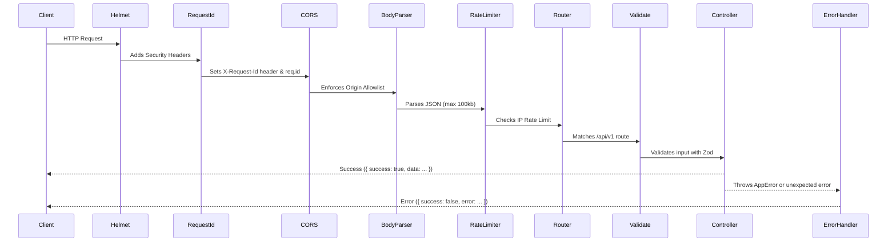

# FlowPilot Backend — Architecture Specification

## 1. Architectural Philosophy

FlowPilot Backend is implemented as a **Modular Monolith**. It balances rapid feature velocity with strict boundaries, preventing architectural decay as the platform expands.

### Core Architectural Decisions

1. **Separation of Application and Process**:
   - `src/app.ts` acts as a pure application factory (`createApp`). It builds the Express middleware stack and registers routes without starting a network listener. This enables instant, isolated integration testing via Supertest without port collisions.
   - `src/server.ts` handles the process lifecycle: loading validated environment variables, binding the HTTP listener, listening for process termination signals (`SIGTERM`, `SIGINT`), and executing graceful shutdowns.
2. **Explicit Layer Boundaries**:
   - **Routes**: Define HTTP paths, HTTP verbs, and associate middleware.
   - **Controllers**: Parse input, call services, and return unified HTTP responses. Controllers contain zero database queries and zero business logic.
   - **Services**: Encapsulate pure business logic, transaction boundaries, and domain rules.
   - **Middleware**: Intercept requests for authentication, tenant resolution, request validation, rate limiting, and error formatting.
   - **Data Access**: Managed through Prisma Client singleton (`src/database/prisma.ts`).

---

## 2. Request Lifecycle & Middleware Pipeline

Every HTTP request enters through a defined sequence of middleware:

---

## 3. Graceful Shutdown & Operational Reliability

When the Node.js process receives `SIGTERM` or `SIGINT`:

1. The server stops accepting new connections (`server.close()`).
2. Ongoing in-flight requests are allowed to finish within a 10-second timeout.
3. The Prisma client disconnects safely (`prisma.$disconnect()`).
4. If cleanup fails or exceeds the timeout, the process exits with status 1.
