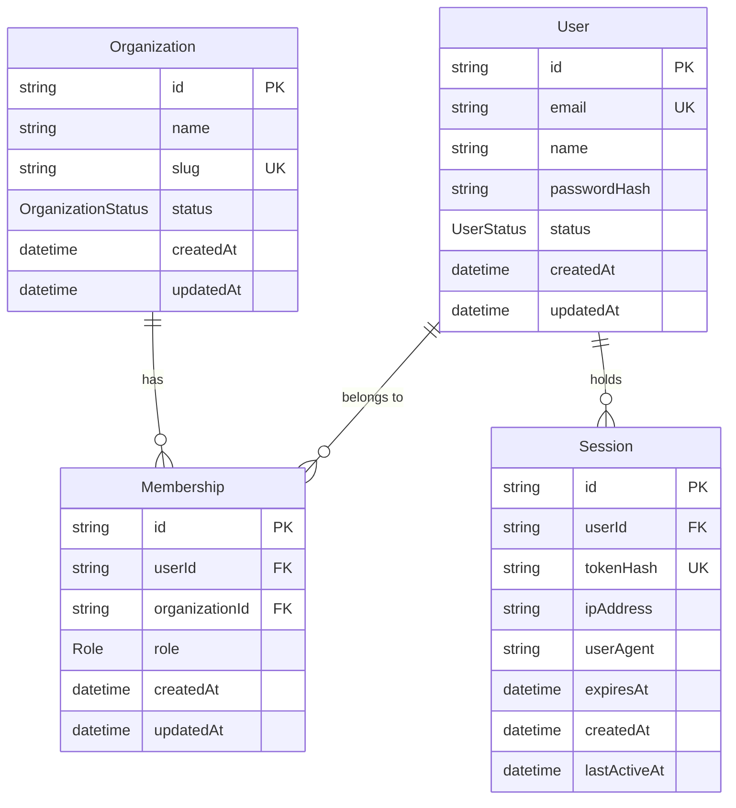

# FlowPilot Backend — Database Design & Multi-Tenancy

## 1. Multi-Tenant Data Architecture

FlowPilot employs a **Logical Partitioning Multi-Tenant Model** using tenant identifiers (`organizationId`) on all tenant-owned entities.

### Entity Relationship Model

---

## 2. Multi-Tenant Authorization Rules

1. **Users and Organizations are Distinct Entities**: A user exists independently of an organization and can be a member of multiple organizations.
2. **Server-Side Verification**: Client-supplied `X-Organization-Id` headers indicate tenant intent, NOT authorization. Every tenant-scoped request verifies that the authenticated user possesses an active `Membership` in that organization before querying or mutating data.
3. **Roles and Permissions**:
   - `OWNER`: Full administrative authority, billing control, organization deletion.
   - `ADMIN`: Member management, service catalog, settings.
   - `MEMBER`: Operational tasks, appointments, clients.
   - `BILLING`: View and manage subscription and invoices only.
4. **Indexes & Constraints**:
   - Compound unique index on `[userId, organizationId]` prevents duplicate memberships.
   - Dedicated indexes on foreign keys (`organizationId`, `userId`) optimize cross-table queries.
